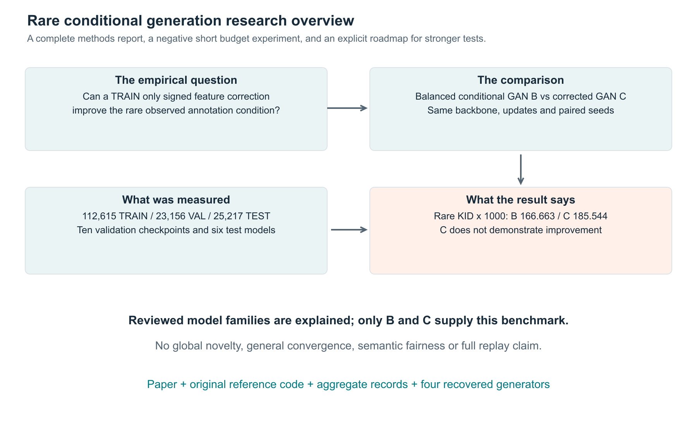

# Rare conditional generation

A detailed research monograph, an audited negative conditional-GAN experiment,
and a source library for studying generative models.

[Read the full paper](paper/full_research_monograph_en.pdf) ·
[Editable Word](paper/full_research_monograph_en.docx) ·
[Full Markdown](paper/full_research_monograph_en.md) ·
[Download the complete package](https://github.com/SmbatShakhpazyan/rare-conditional-generation/releases/download/v1.0.0/rare_conditional_generation_full_package.zip)



## The actual result

The study tests whether a TRAIN-only signed feature-interaction correction helps
a rare observed condition. Both arms share the same residual conditional GAN.
Mean rare-test KID × 1,000 is **166.663 for baseline B** and **185.544 for C**;
lower is better. Only seed 202 improves with C. The mean C−B difference is +18.880,
with nominal one-sided 98.75% conditional upper bound +23.611. This comparison
does not demonstrate improvement. Validation selected κ=0, so its uncertainty
tolerance is inactive. All 24 PRDC recall diagnostics are zero.

These are fixed-bank/fixed-network comparisons, not training-population
confidence statements. This work claims no general solution, global novelty,
semantic fairness, privacy certificate or cross-family superiority.

## What is in the package

| Component | Content and status |
|---|---|
| Full manuscript | Detailed English treatment,109 displayed equations, 21 figures, 34 primary references; no page cap |
| `study/` | Executed B/C source, exact settings, aggregate-only 10 VAL / 6 TEST / CI records, declared data audit and provenance |
| `reference_models/` | Ten original runnable vector implementations, training/sampling CLIs, model-paper manifest and actual 12-test CPU records |
| `upstream_sources/` | Eight separately licensed, pinned source snapshots; DDPM/MADE upstream link-only; no upstream execution |
| `model_weights/` | Four complete selected generators: B101, C101, C202, C303; B202/B303 missing |
| `figures/` | Editable SVGs, PNGs and figure provenance; measured results distinguished from analytical illustrations |
| `poster/` | LinkedIn poster, English/Armenian caption drafts and alt text |
| `records/` and `verification/` | Saved scalar tables and narrowly scoped software/artifact checks |

The full paper covers VAE, adversarial, autoregressive, invertible-flow,
diffusion, score/SDE, flow-matching, consistency and latent-diffusion mechanisms.
Score matching and SDE sampling have separate reference entries, for ten CLIs.
Only B and C are completed real-data confirmation arms. Reference CPU losses,
two-update synthetic train/sample checks and four-generator forward checks are
**software evidence**, not new model-quality experiments.

## Run the original reference implementations

```sh
cd reference_models
python3 -m venv .venv
.venv/bin/python -m pip install -r requirements.txt
.venv/bin/python -B run_cpu_validation.py --output work/my_cpu_validation
```

See the [complete reference guide](reference_models/README.md) for data tensors,
all ten methods, training/sampling commands, controls and limitations.
These small MLP implementations are original teaching/reference code, not the
original authors' code or official benchmark reproductions. The separate
[upstream library](upstream_sources/README.md) records licenses and commit pins.
The [model manifest](reference_models/MODEL_MANIFEST.json) maps every local
implementation to its paper, exact loss, sampler and deviations.

## Verify the delivered evidence

```sh
python tools/verify_release.py
python study/tools/verify_public_package.py
python upstream_sources/verify_snapshots.py
python tools/verify_recovered_generators.py --weights-dir model_weights --output work/NEW_generator_check.json
```

The first three use only the Python standard library and do not train models.
The last requires Torch and performs CPU forwards only. Full quality replay
still lacks two MAIN generator archives, the teacher tensor, selected real/
latent reference banks and complete split/support arrays. Development weights,
full optimizer state and exact restart are not delivered. The executed study
retains its historical gates; do not bypass them or label new training as an
exact continuation. See [study details](study/README.md).

## Data source and rights

No CelebA images, original annotations, supplied identity arrays, per-image
annotation associations, account/session files, external feature weights or
private retrieval archives are distributed. Public point/CI derivatives retain
aggregate values and original-record hashes, not the excluded image lists.
Obtain data directly under [CelebA terms](https://mmlab.ie.cuhk.edu.hk/projects/CelebA.html).

Third-party source retains its own license. NCSN is GPL-3.0; Meta flow_matching is
CC BY-NC 4.0, not MIT. DDPM/MADE upstream sources have no located redistribution
license at their pins, so only links/metadata are included; the local original
reference implementations remain available. No blanket dataset, commercial-use,
model-weight or copyright license is created by public hosting. See LICENSE.md
and each snapshot. Primary paper PDFs are linked, not redistributed.

## Citation and contribution

Author/repository owner: Smbat Shakhpazyan. Cite this research report using
`CITATION.cff`; cite the underlying methods from `references/references.bib`.
AI tools assisted implementation, writing, retrieval and consistency checks.
This is a research report and software archive, not an accepted journal or
conference paper. The stronger conditional-kernel proposal remains untrained.
